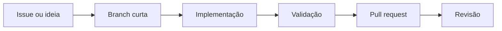

# Contribuindo

<div align="center">

**Mudanças pequenas · testes claros · nenhuma credencial no Git**

</div>

Obrigado por contribuir com esta edição do OpenCode para Termux e Android. O projeto junta servidor, interface web, persistência e launcher; cada mudança deve deixar claro qual dessas áreas foi afetada.

## Rota rápida



## Antes de começar

Leia [`README.md`](README.md), [`AGENTS.md`](AGENTS.md) e [`SECURITY.md`](SECURITY.md). Não envie:

- chaves de API, tokens, senhas ou cookies;
- arquivos `.env`, sessões ou dumps do Termux;
- logs com `Authorization` ou dados pessoais;
- APKs particulares ou artefatos que contenham credenciais.

## Ambiente

```bash
git clone https://github.com/jhonathamlegal-sudo/codex-web-opencode.git
cd codex-web-opencode
bun install --frozen-lockfile
git switch -c docs/minha-mudanca
```

Use uma branch curta e descreva o objetivo no nome. Evite misturar correção Android, refatoração do núcleo e alteração visual sem necessidade.

## Matriz de validação

| Alteração | Verificação mínima |
| --- | --- |
| Markdown, scripts ou configuração | `git diff --check` |
| Núcleo/modelos | `cd packages/core && bun run test && bun typecheck` |
| Interface/API | `bun run check` e geração dos clientes afetados |
| Bootstrap Termux | `bash -n android/codex-web/termux-start.sh` |
| Launcher Android | `bash -n android/codex-web/build.sh` e build com SDK |

Comandos gerais:

```bash
git diff --check
bun run check
cd packages/core && bun run test && bun typecheck
```

Para alterações na API pública, regenere os clientes conforme a área alterada:

```bash
cd packages/client
bun run generate
```

## Regras específicas do launcher

- O Android deve continuar exibindo a confirmação de cada instalação.
- O launcher não pode embutir chave de provedor, token do GitHub ou senha fixa.
- APKs locais do F-Droid, quando usados, devem manter nome de pacote e hash documentados.
- O bootstrap não pode apagar checkout não vazio nem sobrescrever alterações locais.
- Erros de rede, instalação e inicialização devem aparecer no log e na interface.
- Mudanças em `AGENTS.md`, perfis `AGENT.md` ou persistência precisam de validação ponta a ponta.

## Commits e pull requests

Prefira mensagens objetivas:

```text
docs: explicar o bootstrap do Termux
fix(android): continuar sem Widget opcional
```

O pull request deve conter:

- problema observado e solução aplicada;
- arquivos e plataformas afetados;
- comandos de teste executados e resultado;
- limitações ou passos manuais restantes;
- versão do Android/Termux, se envolver o launcher.

### Checklist

- [ ] Não incluí credenciais ou dados pessoais.
- [ ] Executei `git diff --check`.
- [ ] Testei a área modificada.
- [ ] Atualizei a documentação quando o comportamento mudou.
- [ ] Expliquei claramente o que não consegui testar.

Vulnerabilidades devem seguir [`SECURITY.md`](SECURITY.md), não uma issue pública.
