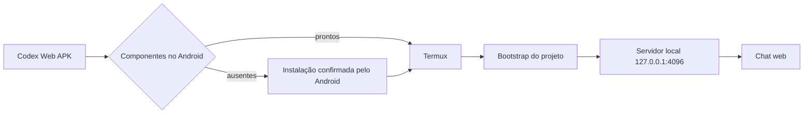

<div align="center">


# Codex Android 

### OpenCode personalizado para Android + Termux

Interface web local, persistência de instruções e launcher Android para preparar o ambiente no próprio aparelho.

[](https://github.com/jhonathamlegal-sudo/codex-web-opencode)
[](android/codex-web/)
[](android/codex-web/README.md)
[](LICENSE)

</div>

> [!IMPORTANT]
> Este é um fork personalizado. Não é o aplicativo oficial do OpenCode nem é afiliado aos mantenedores upstream.

## Download versão 1.0.0 BETA

**[Click aqui para baixar Codex-Android](https://www.mediafire.com/file/5y5x97luycdco9n/CodexWeb-1.0.1-beta.apk/file)**

> [!TIP]
> Esta é uma versão BETA do projeto 

## O que este projeto entrega

| Área | O que acontece |
| --- | --- |
| **Chat local** | A interface web conversa com o servidor OpenCode no mesmo aparelho. |
| **Persistência** | O `~/opencode/AGENTS.md` global é a fonte real das instruções persistentes. |
| **Perfis de modelo** | Cada modelo pode ter seu próprio `AGENT.md` em `~/.config/opencode/models/<provedor>/<modelo>/`. |
| **Launcher Android** | Detecta Termux e inicia o servidor por botões, sem exigir comandos complexos. |
| **Bootstrap** | Clona o repositório, instala dependências e prepara o cliente web no Termux. |
| **Sobrevivência** | Ativa wake lock, monitora `/api/info` + `/api/session` e reinicia servidor zumbi. |
| **Feedback** | Mostra instalando, clonando, compilando, online e erro; inclui Ver log e Copiar log. |
| **Reparo seguro** | Detecta `~/opencode` incompleto e cria backup antes de reparar; a chave APINEX é orientada no launcher. |

## Fluxo do aplicativo



## Instalação

### Android
0. [Baixei o APK](https://www.mediafire.com/file/5y5x97luycdco9n/CodexWeb-1.0.1-beta.apk/file)
1. Instale o APK e permita instalações solicitadas pelo Android.
2. Aceite cada confirmação para Termux, Termux:API, Termux:Boot e Termux:Widget.
3. Abra o Termux quando o launcher solicitar a primeira inicialização.
4. Aguarde o clone, a instalação das dependências e a abertura do chat.

O Android sempre exige confirmação explícita para instalar APKs. O launcher não contorna essa proteção.

> **Estado do APK:** o repositório contém o código e o build reproduzível. Um APK com os quatro APKs oficiais embutidos pode ser gerado localmente; esses binários não ficam no Git comum porque o Termux ultrapassa o limite de arquivo do GitHub.

### Configuração da chave do provedor

A chave nunca fica no GitHub, no código ou no APK. No aparelho que executará o servidor:

```bash
mkdir -p ~/.config/opencode
printf '%s\n' "APINEX_API_KEY='COLOQUE_A_SUA_CHAVE_AQUI'" \
  > ~/.config/opencode/apinex.env
chmod 600 ~/.config/opencode/apinex.env
```

Substitua o placeholder apenas no dispositivo. Não cole uma chave real em issue, pull request, screenshot ou conversa.

### Instalação manual no Termux

```bash
pkg update -y
pkg install -y git curl bun
git clone https://github.com/jhonathamlegal-sudo/codex-web-opencode.git ~/opencode
cd ~/opencode
bun install --frozen-lockfile
bun run --cwd packages/app build
```

Para iniciar manualmente:

```bash
export OPENCODE_SERVER_PASSWORD="escolha-uma-senha-local"
bun packages/cli/src/codex-web-server.ts
```

O launcher usa `127.0.0.1:4096`; ele não publica o servidor na internet.
O bootstrap grava a fase e o tempo em `~/.cache/codex-web/status`. O watchdog ativa `termux-wake-lock`, registra crashes/SIGKILL suspeitos e só libera **Abrir chat** após duas verificações autenticadas. A configuração de bateria do Termux é oferecida pelo launcher e ainda depende da confirmação do Android.

## Desenvolvimento

Requisitos: Linux ou Termux com Git, Bun 1.3+ e, para o APK, JDK, Android SDK e Build Tools.

```bash
bun install --frozen-lockfile
bun run check
cd packages/core && bun run test && bun typecheck
```

Para o APK:

```bash
cd android/codex-web
bash -n termux-start.sh
ANDROID_SDK_ROOT=/caminho/android-sdk bash build.sh
```

O resultado aparece em `android/codex-web/build/CodexWeb-debug.apk`. Se `src/main/assets/fdroid/` existir, os APKs locais são embutidos; caso contrário, o código usa o fallback do F-Droid.

## Estrutura principal

```text
android/codex-web/                         launcher e instalador Android
android/codex-web/src/main/assets/fdroid/  APKs oficiais opcionais do F-Droid
android/codex-web/termux-start.sh          bootstrap e servidor no Termux
android/codex-web/termux-watchdog.sh       watchdog e health checks do servidor
packages/app/                              interface web
packages/core/                             núcleo, persistência e modelos
```

## Limites conhecidos

- O APK não descobre nem fornece automaticamente a chave do provedor.
- A instalação de cada componente depende da confirmação do Android.
- O servidor é local; acesso remoto entre celulares não é ativado automaticamente.
- Um checkout existente e não vazio não é apagado pelo bootstrap.
- Acesso a arquivos, processos e rede segue as permissões do usuário do Termux; não é um sandbox.

## Documentação

| Documento | Para quem é |
| --- | --- |
| [`CONTRIBUTING.md`](CONTRIBUTING.md) | Quem deseja alterar ou testar o projeto. |
| [`SECURITY.md`](SECURITY.md) | Política reconhecida pelo GitHub para vulnerabilidades. |
| [`SEGURANÇA.md`](SEGURAN%C3%87A.md) | Versão pública da política em português. |
| [`AGENTS.md`](AGENTS.md) | Regras de trabalho e persistência do checkout. |

<div align="center">

**Código público, credenciais privadas.**

</div>
